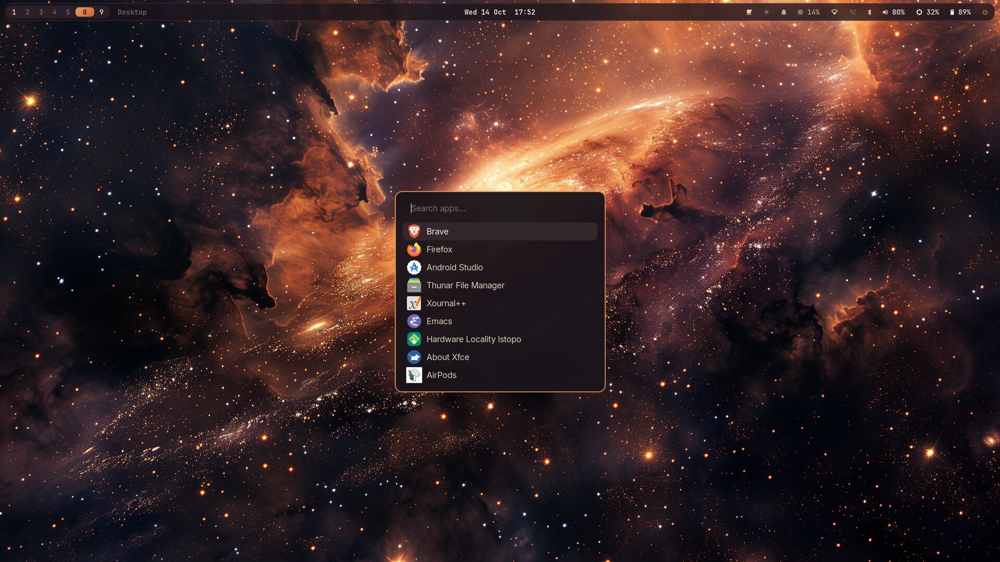
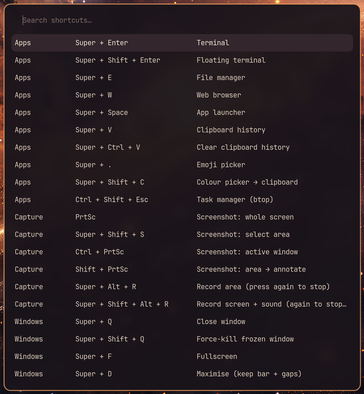
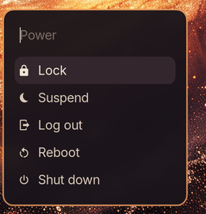
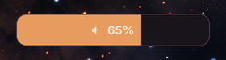

<h1 align="center">Ember — Hyprland dotfiles</h1>

<p align="center">A warm, dark Hyprland desktop on Arch Linux: Lua config, a floating Waybar,<br>
fuzzel for every picker, mako for notifications and on-screen toasts, all in one palette.</p>

<p align="center"></p>

<table>
<tr>
<td></td>
<td><br></td>
</tr>
</table>

## What's in it

| | |
|---|---|
| **Hyprland 0.56, Lua config** | `hyprland.lua` loads `conf/theme.lua` (the palette), `env`, `look`, `input`, `keybinds`, `rules`, `autostart`. Edit and save; it reloads itself. |
| **Keybinds** | Every shortcut is defined with a description and collected into a cheat sheet: **Super + /**. Game mode (**Super + F3**) turns off animations, blur, gaps and rounding until pressed again. **Super + F5** cycles dwindle → master → scrolling. |
| **Waybar** | Floating and blurred. Workspaces, window title, clock with a calendar, and a CPU/RAM/disk drawer. Caffeine, night light, do-not-disturb and recording toggles that update on signals (no polling loops). Wi-Fi, AirPods, Bluetooth, volume, brightness, battery, power. |
| **fuzzel** | App launcher plus pickers for the clipboard (cliphist), emoji, wallpapers, power and the shortcut sheet. |
| **mako** | Notifications, and the small bottom-centre toasts for volume, brightness, mic and every toggle. |
| **Scripts** (`hypr/scripts/`) | Screenshots to the clipboard (click the notification to annotate in swappy), screen recording with VA-API, OSD, caffeine, night light, do-not-disturb, wallpaper picker, power menu, reload. |
| **Idle and lock** | hypridle dims at 2.5 min, locks at 5, turns the screen off at 5.5 and suspends at 15. hyprlock uses the same palette. |
| **Shell** | zsh without a framework: shared history, completion cache, a git-branch prompt, autosuggestions and syntax highlighting. tty1 login starts Hyprland. |
| **Apps** | Alacritty, GTK 3/4 dark theme (adw-gtk3, Papirus, Inter), Brave flags for native Wayland and VA-API, portals, MIME defaults. |
| **AirPods** | LibrePods with a case-open card, a menu-bar dropdown and iPhone handoff: **[airpods-macfeel](https://github.com/B-Divyesh/airpods-macfeel)** |

The palette is in `.config/hypr/conf/theme.lua`. The same hex values are used in
Waybar, fuzzel, mako, hyprlock and Alacritty, so search for a colour to change it
everywhere.

| crust | base | surface | text | amber | ember | gold | green | blue | red |
|---|---|---|---|---|---|---|---|---|---|
| `#0e0a0f` | `#1a141b` | `#33262c` | `#f0e4d4` | `#e89b5e` | `#c8643c` | `#efcf9f` | `#a8c686` | `#8cb3d9` | `#e5534b` |

## Install

```sh
git clone https://github.com/B-Divyesh/dotfiles ~/dotfiles
cd ~/dotfiles
yay -S --needed $(grep -v '^#' packages.txt | cut -d' ' -f1)
./install.sh --dry-run      # see what would change
./install.sh                # symlink into ~ (existing files go to ~/.dotfiles-backup-<date>/)
```

`--copy` copies instead of symlinking. Put wallpapers in `~/Pictures/Wallpapers`.
The installer links the first one, and **Super + Ctrl + W** switches between them.

Things you'll want to change for your machine:

* **Keyboard layout:** `kb_layout = "gb"` in `conf/input.lua`.
* **Monitors:** the `hl.monitor` lines in `hyprland.lua`. They're set up for a 4K
  laptop panel at scale 2; anything else you plug in goes to the right.
* **Battery and backlight names** in `waybar/config.jsonc` (`BAT0`, `intel_backlight`).

### Automatic time zone (optional)

`automatic-timezoned` (AUR) sets the time zone from your location, through geoclue.
It runs as your user through `~/.config/systemd/user/automatic-timezoned.service`
and `geoclue-agent.service`. It also needs two system pieces:

* `etc/geoclue/conf.d/90-automatic-timezoned.conf`, copied to `/etc/geoclue/conf.d/`.
* A polkit rule that lets your user set the time zone (see the automatic-timezoned README).

Enable it with:

```sh
systemctl --user enable --now geoclue-agent automatic-timezoned
```

## Keys

**Super + /** lists every shortcut in a searchable sheet. The essentials:

| | |
|---|---|
| Super + Enter / Space / E / W | terminal / launcher / files / browser |
| Super + V · Super + . | clipboard history · emoji |
| Super + Shift + S · Print | screenshot area · whole screen (Shift + Print: annotate) |
| Super + Q · Super + F · Super + Alt + Space | close · fullscreen · float |
| Super + 1…0 · Super + S | workspaces · scratchpad |
| Super + L · Super + Esc | lock · power menu |
| Super + F2 / F3 / F4 / F5 | night light / game mode / caffeine / layout |
| Super + Ctrl + R | reload everything (and bring back a crashed bar) |

## License

MIT. Use anything.
